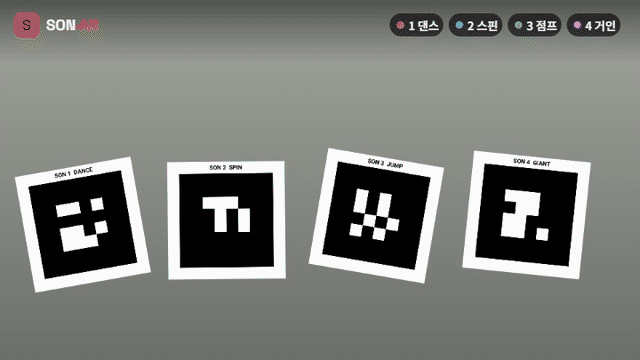
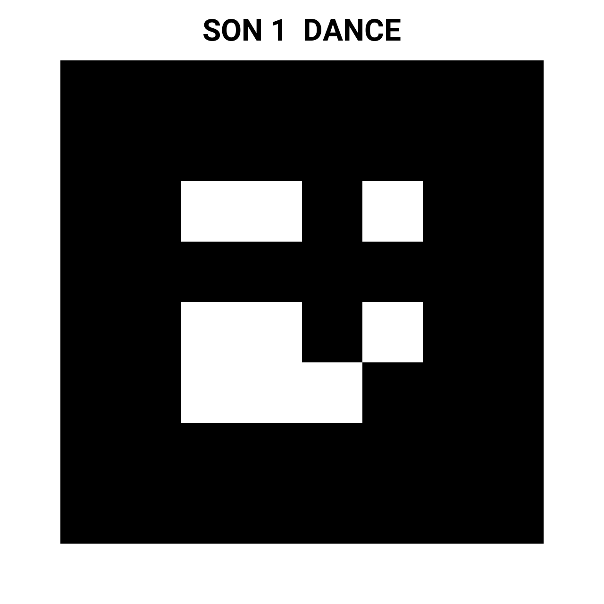
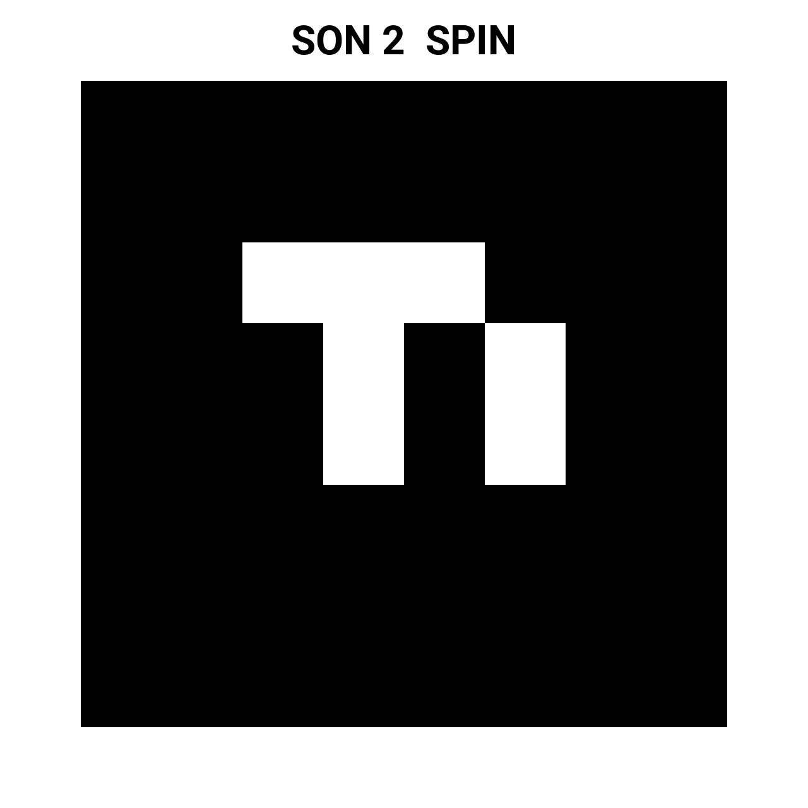
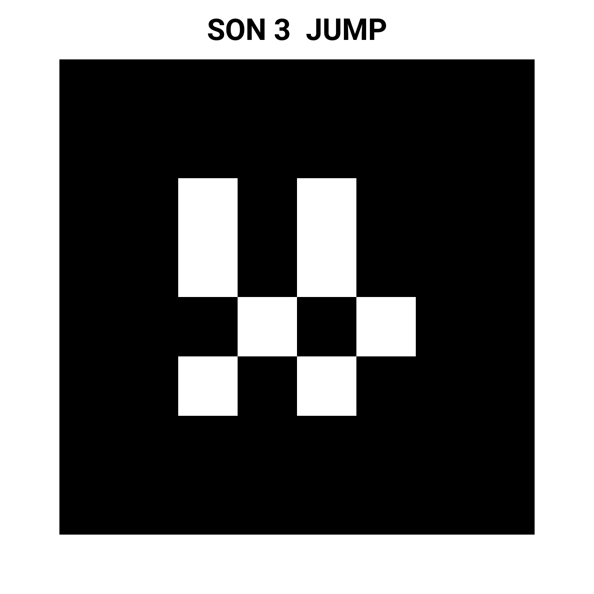
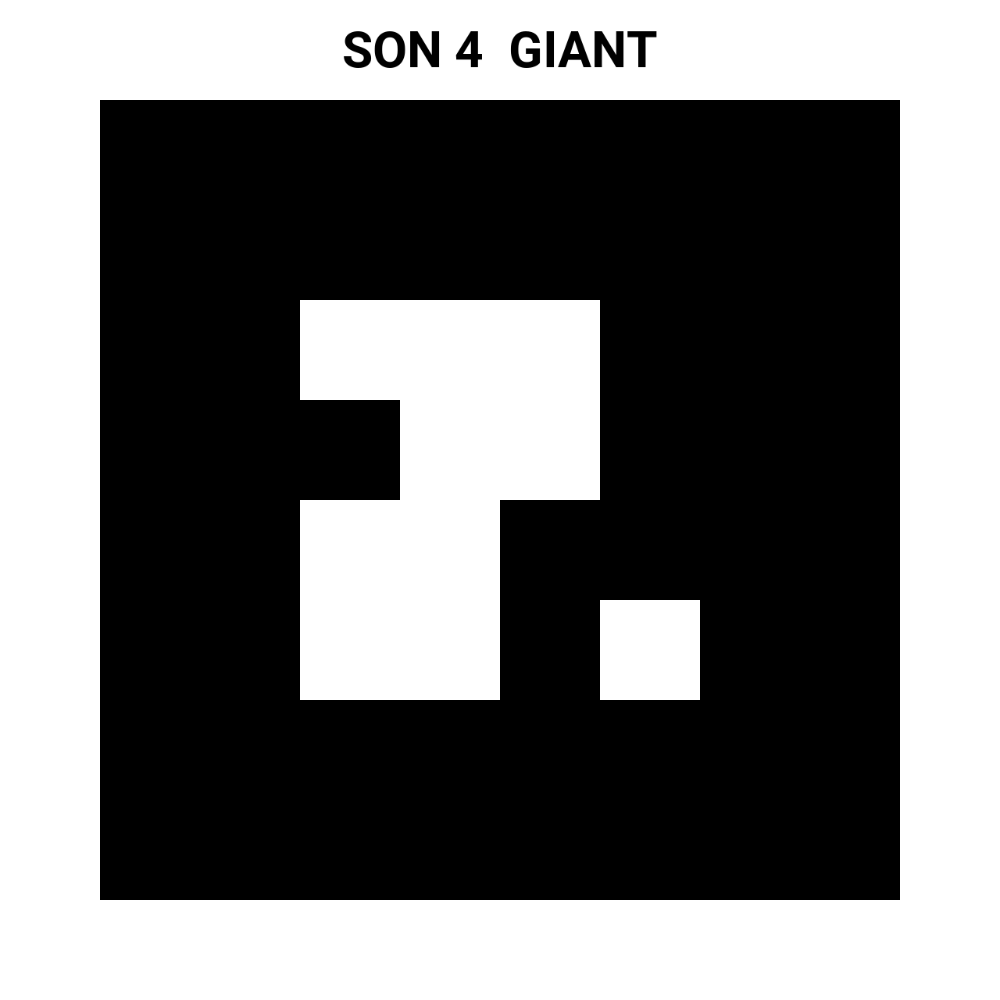

<h1 align="center">SON<span>·AR</span></h1>

<p align="center">
브라우저만으로 동작하는 마커 AR — 마커를 비추면 캐릭터가 춤춰요.<br>
Unity 6 + AR.js, 앱 설치 없이 폰·PC 웹캠에서 바로 실행됩니다.
</p>

<p align="center">
<a href="https://metasongi.github.io/ARWT/"><b>▶ 라이브 데모</b></a> ·
<a href="https://metasongi.github.io/ARWT/markers.html">마커 시트 (인쇄)</a> ·
<a href="https://metasongi.github.io/ARWT/?ex=preview">카메라 없이 미리보기</a>
</p>

<p align="center"></p>

## 예제

| # | 예제 | 내용 | 링크 |
|---|---|---|---|
| 01 | **댄서** | 마커 1번 위에 댄서가 나타나요. 버튼(멈춤·회전·점프·색상·크기)과 손가락(드래그 회전, 핀치 확대)으로 조작 | [열기](https://metasongi.github.io/ARWT/?ex=dancer) |
| 02 | **마커별 동작** | 마커마다 다른 동작. 여러 개를 동시에 비춰도 되고, 상단 칩을 눌러 조작할 캐릭터를 골라요 | [열기](https://metasongi.github.io/ARWT/?ex=multi) |
| 03 | **미리보기** | 카메라 없이 네 캐릭터를 한 화면에서 | [열기](https://metasongi.github.io/ARWT/?ex=preview) |

## 마커별 동작

| 마커 | 동작 | 색 |
|:---:|---|---|
|  | **1 · 댄스** — 기본 춤 | 오렌지 |
|  | **2 · 스핀** — 춤추며 계속 회전 | 블루 |
|  | **3 · 점프** — 1.3초마다 점프 | 그린 |
|  | **4 · 거인** — 1.7배 크기, 느릿느릿 | 퍼플 |

마커 패턴은 서로 헷갈리지 않도록(어떤 회전에서도 상관도 0.22 이하) [Tools/make_marker.py](Tools/make_marker.py)로 생성했습니다. 마커가 가로 10cm 이상이면 잘 인식돼요.

## 구조

```
AR.js (A-Frame)  ──마커/카메라 포즈──▶  Unity WebGL (투명 캔버스)
   카메라 영상          SendMessage          캐릭터 렌더링
        ▲                                        │
        └──────── sonEvent (감지/동작 상태) ◀────┘  jslib 브리지
```

| 위치 | 역할 |
|---|---|
| `Assets/SON/Scripts/SonCharacter.cs` | 캐릭터 동작(모드별 댄스/스핀/점프/거인), 버튼 메서드, 터치·마우스 조작 |
| `Assets/SON/Scripts/SonMarkerController.cs` | 마커 추적·스무딩, 감지/분실 이벤트를 페이지로 전달 |
| `Assets/SON/Editor/SonBuild.cs` | 씬 자동 생성 + WebGL 빌드 (메뉴 **SON → Build WebGL**) |
| `Assets/WebGLTemplates/WebAR/` | 페이지(갤러리·UI·마커 시트), AR.js 연동 `js/app.js` |
| `Assets/Plugins/WebGL/arwt_bridge.jslib` | Unity → 페이지 호출 브리지 |
| `Tools/make_marker.py` | 마커 `.patt` / 인쇄용 PNG 생성 |

## 빌드 & 배포

1. Unity **6000.3** 으로 프로젝트를 엽니다.
2. 메뉴 **SON → Build WebGL** (또는 배치 모드)
   ```bash
   Unity.exe -batchmode -quit -projectPath . -executeMethod SON.EditorTools.SonBuild.BuildWebGL
   ```
3. 결과물 `Builds/WebGL` 을 HTTPS 서버(GitHub Pages 등)에 올립니다. 카메라는 HTTPS에서만 열립니다.

동작·색을 바꾸려면 `SonBuild.cs` 의 `Markers` 목록을, 마커를 바꾸려면 `Tools/make_marker.py` 를 수정하세요.

## 크레딧

[ToughNutToCrack/ARWT](https://github.com/ToughNutToCrack/ARWT) (MIT) 를 기반으로 Unity 6 업그레이드, 새 로더 대응, SON 캐릭터·마커·UI를 더했습니다. 원본 기능 정리는 [FEATURES.md](FEATURES.md) 참고.
